# EZPDF tutorial: GUI and Code versions

Prerequisites for running the Code version
===========================================

Installing Python and tools for writing codes
https://algotom.readthedocs.io/en/latest/toc/section1/section1_1.html

Setting up a Python workspace
https://algotom.readthedocs.io/en/latest/toc/section4/section4_1.html

***** To obtain I(q), S(q), F(q), G(r) from input xyz coordinates, or to derive S(q), F(q), G(r) from experimental I(q) 
or Compton scattering patterns, please refer to the files located in the """examples""" directory. ******
This tutorial covers EZPDF data processing and scattering calculations. 
Structural fitting with EZPIT is a separate workflow.

Input file
==========

EZPDF is a software tool that can process ".xyz coordinate file" data from 
various 3D modeling programs. These programs include Mercury, Discovery Studio, 
VESTA, Avogadro, CrystalMaker and more. To use EZPDF with atoms and ions, the user must 
match their name with the one in the atomic form factor file (aff_elementonly.txt). 
This file can be found in the "data" folder of the Code version. Here are some examples of xyz 
coordinate file format.

An experimental G(r) file contains the reduced pair distribution function as two numeric columns: r and G(r).
 The file has two columns: the first one is the distance r 
in angstroms, and the second one is the value of G(r) at that distance. 
The numeric data may be preceded by metadata or comment lines, and the columns are separated by 
spaces or tabs. An example of an experimental G(r) file is:

When you use xPDFsuite or PDFgetX2 to produce G(r), you may notice some extra lines 
at the beginning of the file. These are header or footer lines that contain some metadata. 
For a numeric two-column file, use a reader such as numpy.loadtxt(file_path, comments="#", skiprows=n_header), 
with n_header set to the number of lines before the numeric data. Verify the loaded columns. 
load_atom_names() reads a species list; it is not the G(r) data reader.

The Code version also uses two files including “aff_elementonly.txt” and “aff_parmonly.txt”. 
“aff_elementonly.txt” include all atoms and ions for atomic form factors and “aff_parmonly.txt” 
has parameters for atomic form factors. The table of atomic form factor was obtained from 
“New Analytical Scattering Factor Functions for Free Atoms and Ions by 
D. Waasmaier & A. Kirfel, Acta Cryst. (1995). A51, 416–431 and PDFgetX2 library”. 
Also International Tables for Crystallography (2006). Vol. C, ch. 4.3, pp. 259-429” provides scattering form factor. 
The equation of atomic form factor is 

where f(s) is the atomic form factor, s = sin(θ)/λ = q/(4π), and q is the momentum transfer, 
ai, bi and C are the parameters from the table, and the summation is over five Gaussian terms, plus the constant C.

When the code reads each atom or ions in ".xyz coordinate file", the code finds the row of
each atom or ions in “aff_elementonly.txt” and picks the corresponding parameters 
such as ai, bi and C in the “aff_parmonly.txt”. 

Setup of input file path
========================

As an example, please specify the file path of experimental G(r), .xyz coordinate file, 
aff_elementonly.txt, and aff_parmonly.txt.

User input information
======================

Set qmin, qmax and qstep for xyz-model calculations, and rmin, rmax and rstep for the PDF output. 
The optional qdamp parameter belongs to the Code version’s theoretical G(r) functions; 
qdamp = 0 disables its real-space damping envelope. It is not a CAL-tab input in the GUI.

I(q) calculation
================

We applied the Debye formula to calculate the scattering intensity I(q) from 
the atomic positions in the input .xyz coordinate file.

The total coherent scattering intensity, I(q), is theoretically defined as the sum of two fundamental components: 
self-scattering (i = j) and distinct-pair scattering (i ≠ j), a relationship clearly illustrated by the provided image 
using a three-element system (A, B, C).For three atoms A, B and C, 
the general Debye expression is:I(q) = (f_A)^2  + (f_B)^2  + (f_C)^2  + 2∑_(i<j) ((f_i x f_j) x sinc(qr_ij)). 
Here the distinct pairs are AB, AC and BC. At q = 0, sinc(0) = 1 and the entire expression becomes I(0) = (f_A (0) + f_B (0) + f_C (0))^2.

For water, the self-scattering contribution is 2f_H(q)² + f_O(q)². Distinct H–H and H–O pair terms must also be included.
(water (H2O,  H1, H2, O1), I(q) = (fH1H1 + fH2H2 + fO1O1)2 = (2fH2 + fO2))

When q = zero (0), sin(qrij)/(qrij) = 1, So, the Debye formula will be:

At q = 0, the total intensity for one water molecule is I(0) = [2f_H(0) + f_O(0)]².
(water (H2O,  H1, H2, O1), I(q) = (fH1 + fH2 + fO1)2 = (2fH + fO)2)

One possible way to explain this is:
The .xyz coordinate file contains the positions of the atoms in a molecule. 
For example, if the .xyz coordinate file has 

It means that there are three atoms: one iridium and two oxygen. 
To calculate the scattering intensity I(q) as a function of the momentum transfer q, 
we need to consider the distances between all pairs of atoms. 
At q = 0, all atom pairs contribute and I(0) = [Σ_i f_i(0)]². 
For q > 0, the pair matrix includes both diagonal self-scattering terms (i = j) and off-diagonal distinct-pair terms (i ≠ j). 
The diagonal sinc terms are always evaluated at their limiting value of one.
(At q = zero (0), 2nd term is only considered for I(q) When q > 0, 
all pairs are considered as a matrix like below. Diagonal components (when I = j) 
will be  2nd term which is same as when q=zero.)

To speed up the computation of I(q) and avoid redundant calculations, 
we used a matrix approach. The function "def group_atoms(atom_names)" 
allows us to extract various information from the .xyz coordinate file, 
such as the names of the atoms, their number, their index, 
and their diversity.

S(q) calculation
================

To determine the structure function S(q), we applied the following formula.

For model-derived coherent intensity, use the following normalization. 
Here N is the number of atoms, ⟨f(q)⟩ is the mean form factor, and ⟨f(q)²⟩ is the mean squared form factor. 
The form-factor variable is s = sin(θ)/λ = q/(4π). 
For Co20P10O4, N = 34; average each form factor using the weights 20/34, 10/34 and 4/34. 

The function “cal_Sq” takes several arguments, such as atom_indices, 
scattering_factors, atom_distance_matrix, qmin, qmax, qstep, and return_Iq. 
It computes the structure function S(q) for a given set of atoms and 
scattering factors. And the mean of square atomic form factor <f2> 
and the square of mean atomic form factor <f>2 can also be calculated.

Lorch function
==============
Lorch modification function M(q) = sin(pi*q/qmax) / (pi*q/qmax).
M(0) = 1 and M(qmax) = 0. Used to damp the finite-qmax truncation before
the F(q) -> G(r) sine transform, reducing termination ripple.

Calculation of G(r) by direct integration and rFFT
===================================================

Starting from the structure function S(q), calculate F(q) = q[S(q) − 1]. 
The finite-range sine transform below defines G(r). 
Direct numerical integration evaluates this integral at each requested r value; 
the FFT route evaluates the same sine transform through an odd-extended real array.

Direct-integration functions
============================

In the Code version, cal_Gr_integral() calculates G(r) from xyz-model-derived S(q). 
The experimental routine cal_expGr_integral() accepts S(q) or F(q); set is_Fq=True when passing F(q). 
Direct integration uses the available q interval and does not require zero padding or low-q extrapolation.

Choosing the output r spacing
=============================

The example below compares rstep = 0.1 Å and 0.01 Å. 
A smaller rstep samples the same PDF more densely and improves its visual representation. 
It does not add structural information or improve the real-space resolution set by the measured q range.

The updated FFT route uses a forward real-input FFT, numpy.fft.rfft, rather than the earlier IFFT procedure. 
The GUI uses this route by default. The Code version also provides direct integration for comparison. 
FFT calculations are generally faster for dense output grids, although timing depends on the input size and numerical settings.

Odd extension and zero filling for the rFFT calculation
=======================================================
1. Select the input q interval. Linearly interpolate F(q) only within that interval onto a uniform working grid with spacing ΔqFFT. 
Set F(0) = 0 and fill the unmeasured region below the first input q value with zeros. 
No low-q linear or spline extrapolation is applied.
2. Construct negative-q values by reflection and sign reversal: F(−q) = −F(q). Fill the high-|q| regions with zeros. 
The current implementation chooses a power-of-two array length M for efficient computation 
and a sufficiently dense transform-generated r grid; this is an implementation choice, not a mathematical requirement of FFTs.

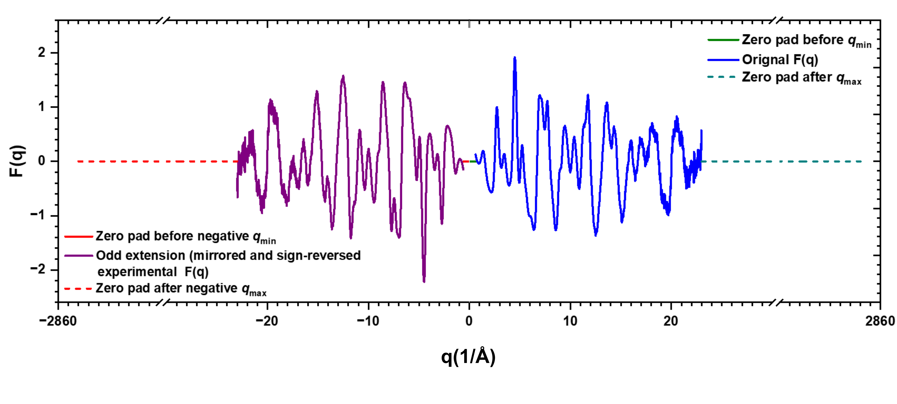

Odd extension of experimental F(q): the blue curve is the positive-q signal and the purple curve is its reflected, 
sign-reversed counterpart. Zero-valued segments fill the unmeasured low-|q| region and pad the high-|q| tails. 
Axis breaks compress the tails; the outer values near ±2860 Å⁻¹ describe this example’s computational domain, 
not the measured q range. The display uses sorted signed q, while the calculation uses FFT storage order.

3. Store q = 0 first, followed by the positive-q values and then the negative-q values in FFT storage order. 
With dq_fft = ΔqFFT, the transform and its native r coordinates are calculated as follows:

X = np.fft.rfft(odd)
r_fft = np.arange(M // 2) * (2 * np.pi / (M * dq_fft))
G_fft = -(dq_fft / np.pi) * X.imag[:M // 2]

Here, odd is the real, odd-extended, zero-padded array. The minus sign follows NumPy’s forward-transform convention. 
The result is interpolated onto the requested rmin, rmax and rstep grid. 
A full forward FFT can alternatively be selected in the source code with the same array and normalization; it is not a separate GUI option.

What zero padding changes and how to check the result
=====================================================
High-q zero padding inserts zeros beyond the available input interval. 
At fixed ΔqFFT, increasing M decreases the native r-grid spacing, ΔrFFT = 2π/(MΔqFFT). 
The plotted PDF is sampled more densely, but the measured q range, experimental resolution and information content are unchanged. Zero padding does not remove termination ripples.
The comparison below uses the same experimental F(q) over q = 0.60–23 Å⁻¹, without Lorch modification or additional damping. 
The direct-integration and rFFT results nearly overlap over r = 0–20 Å; the lower panel shows their small pointwise difference.

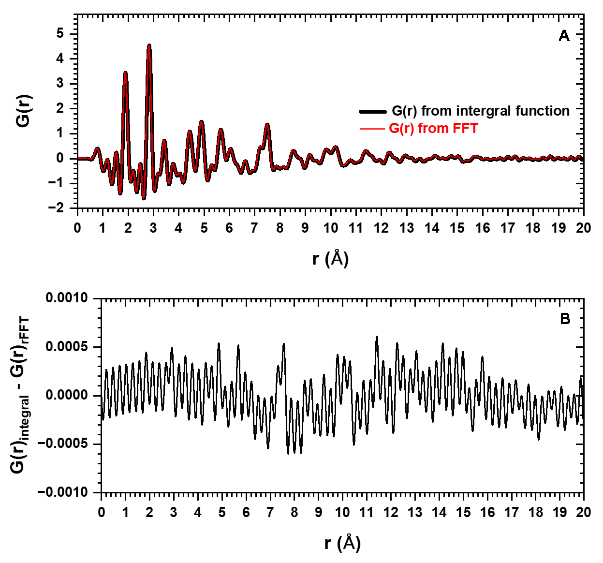
Numerical consistency check: (A) G(r) from trapezoidal integration (black) and the odd-extension rFFT route (red). 
(B) G(r)integral − G(r)rFFT. Small differences arise from numerical sampling, 
endpoint treatment and interpolation; direct integration is a reference calculation rather than an exact analytical result.

Inspect the boundaries before interpreting G(r). 
A nonzero F(qmin) creates a discontinuity when the low-q region is zero-filled; improved low-q treatment remains needed. 
Select qmax and correction parameters while preserving structural oscillations, 
and inspect whether F(qmax) is reasonably close to zero. Do not tune the polynomial solely to force the endpoint to zero.

The following paragraph shows how to improve the resolution of G(r) 
by using zeropad in F(q). Zero padding is a technique that inserts zeros 
after qmax in F(q) before performing rFFT. This increases the number 
of data points in G(r) and makes the peaks smoother. Zero padding is a technique 
that improves the quality of G(r) by inserting additional data points 
between the original ones obtained from F(q). This does not mean adding zeros, 
but rather interpolating the data to increase the resolution. 
As a result, the G(r) curve is smoother and more accurate. Without zeropad, 
G(r) has fewer data points and the peaks are more jagged. 
Here is an example of the difference between using zeropad and 
not using zeropad in F(q) and G(r).

Example:
========
With the xyz coordinate file, EZPDF calculates I(q) to G(r). qdamp was zero (0).

Neutral-atom example: Ni(OH)2-109391-ICSD-10x10x1.xyz (see the doc directory).

Ions in 5IrC_r5a-1Ir_ion.xyz

Calculating Compton scattering pattern
======================================

The theoretical Compton scattering intensity, Iinc(q) (Egami & Billinge, 2003), shown in equation below, 
represents the incoherent scattering contribution arising from the inelastic collision between X-ray photons and electrons. 
Unlike coherent scattering, this component carries no structural information and acts as a background that increases with q, 
significantly affecting the normalization of S(q) at high angles. EZPDF evaluates the incoherent intensity per atom 
using the analytic parametrization of Balyuzi (Balyuzi, 1975), who fitted the incoherent scattering factors of Cromer & Mann 
(Cromer & Mann, 1967) and Cromer (Cromer, 1969) to a five-Gaussian function of s = sin(θ)/λ. 
For each element a, this parametrization yields the quantity fₐ(q) = Za − Iinc(q), 
which approaches the atomic number Za at low q and decays toward zero at high q. 
Because Balyuzi fitted the quantity Za − Iinc(q) directly, the incoherent contribution of atom a is recovered as Za − fa(q), 
which approaches zero at low q and Za at high q. The total Compton intensity is then the concentration-weighted sum over all atoms, 
scaled by the Breit–Dirac recoil factor shown below.

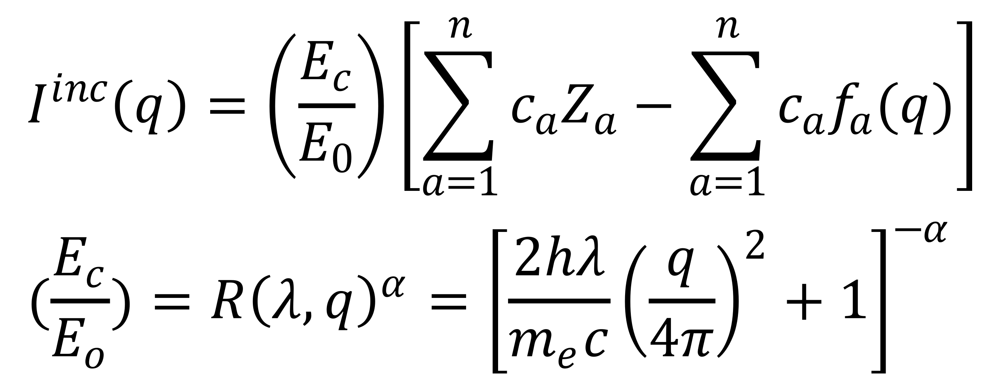

cₐ (atomic fraction) = Na/N, where Na is the number of atoms of type a and N is the total number of atoms in the chemical unit; 
Za is the atomic number of the ath type of atom; and fa(q) is the analytic incoherent-scattering parametrization of Balyuzi (1975). f(q) = Ffit(q) = Za – Iainc(q).

The Compton (incoherent) scattering coefficients were obtained from D. T. Cromer, J. Chem. Phys. 50, 4857 (1969), 
as parametrized by H. H. M. Balyuzi, Acta Cryst. A31, 600 (1975). Balyuzi fitted the function F_fit(s) = Z − I_inc(s) 
(not the incoherent intensity itself) to a sum of five Gaussians, where Z is the atomic number and s = sin(theta)/lambda. 
The fitted function is:

where F_fit(k) is Balyuzi's five-Gaussian fit for the i-th atom (no ion information). Note that F_fit is NOT an atomic form factor: 
it equals Z − I_inc, so the incoherent (Compton) intensity per atom is recovered by simple subtraction, I_inc = Z − F_fit. 
Use s = q/(4π), so the Gaussian exponent contains s² = [q/(4π)]². compton_elementonly.txt stores the element names, 
while compton_parmonly.txt stores the corresponding fit coefficients ai, bi and C. The summation is over five terms. 
When the code reads each atom in the ".xyz coordinate file," it identifies the row of each atom in 
"compton_elementonly.txt" and extracts the corresponding parameters such as ai, bi, and C from "compton_parmonly.txt."

The code that evaluates Balyuzi's fitted function F_fit(k) is shown below. 
The incoherent intensity is then obtained as I_inc = Z − F_fit (averaged per atom and multiplied by the Breit–Dirac recoil factor).

The necessary information for calculating the Compton scattering pattern is

The plot of the calculated Compton scattering pattern for the composition Co2 O2 P1 is displayed below.

Also, several important functions in "loadsaver.py" are explained in terms of their roles. Please see the examples below.

Calculating S(q), F(q), G(r) from experimental I(q)
===================================================
Figure displays the experimental intensity I(q) (denoted as Exp(Raw), the scaled background (represented as Bkg*Scale), 
the background-subtracted experimental intensity (Net I(q))

Figure presents the background-subtracted experimental intensity (Net I(q))

Figure exhibits the structure function (uncorrected S(q), labelled Standard S(q) in the legacy plot) derived from the experimental intensity I(q) 
(Net I(q) in the previous Figure. 
The uncorrected S(q) in this example has a slowly varying baseline deviation, which may reflect residual experimental and background contributions. 
S(q) should oscillate about unity at sufficiently high q; an increasing baseline is not an expected physical requirement.
To bring the oscillation of S(q) around 1, a form of correction is necessary.
EZPDF employs a polynomial correction, similar to the approach taken by xPDFsuite. The normalized S(q) (Poly-corrected S(q)) then oscillates around 1.

EZPDF exposes a polynomial-setting control; xPDFsuite uses rpoly to constrain its correction. These parameters should not be interpreted as directly interchangeable.
The black line represents the "Experimental S(q)" which is not corrected by polynomial.
The red line denotes the calculated polynomial for the black line.
The blue line illustrates the S(q) after subtracting the red line from the black line.
To obtain a polynomial function, a Vandermonde matrix with a least squares fit is utilized here.
Reference materials:
https://m.youtube.com/watch?v=BExDXaFOjF4
Prof. Wen Shen, Penn State Univ.
https://www.youtube.com/watch?v=G6lVSD0Jci0&t=211s
Numerical recipes by W. Press, B. Flannery, S. Teukolsky, W. Vetterling

Details of the S(q) calculation. Residual baseline deviations are corrected after composition-dependent form-factor normalization. 
The fit is made to Fraw(q) = q[Sraw(q) − 1], with the polynomial constant term constrained to zero; the fitted function divided by q is then subtracted from Sraw(q). 
A default numpy.polyfit fit includes a freely fitted constant term and cannot be substituted without imposing the same constraint.

The experimental structure function S(q) is obtained from the background-subtracted intensity using an ad hoc X-ray normalization 
(PDFgetX3-style; Juhás et al., J. Appl. Cryst. 46, 560 (2013)).

Experimental normalization. Define J(q) = I_bkgsubtracted(q)/⟨f(q)⟩² and A(q) = ⟨f(q)²⟩/⟨f(q)⟩². 
Over the selected q points, the least-squares scale is k = Σ[J(q)A(q)]/Σ[J(q)²]. 
The uncorrected structure factor is Sraw(q) = kJ(q) − A(q) + 1. Polynomial correction is applied subsequently. 
This scale does not establish rigorous absolute-intensity calibration.

As an illustrative example, data from disordered cobalt oxide is presented. 
The top panel displays the scattering intensities for the cobalt oxide sample(black), the background (red), and the resulting background-subtracted data(blue). 
I(q) is plotted on a logarithmic scale, which provides a much clearer visualization of the subtracted data compared to a linear scale.
The middle panel shows the structure function, S(q), calculated from the background-subtracted data. 
This particular result arises because unwanted signals were not perfectly eliminated. By applying a polynomial correction to the calculated S(q), 
the peaks are adjusted to oscillate around unity (1). The low panel demonstrates how polynomials of two different degrees fit the calculated S(q) data. 
For better visualization, these polynomials were shifted by an offset of 1 and superimposed onto the S(q) plot. 
Notably, the high-degree polynomial (order 20.0, blue) exhibits significant deviations from the appropriate degree (order 7.208, red), particularly in the low-q region.  
For an integer setting n, the correction is obtained from a constrained least-squares polynomial fit to Fraw(q) = q[Sraw(q) − 1], 
using numpy.vander and numpy.linalg.lstsq with the constant column omitted. The correction applied to Sraw(q) is the fitted polynomial divided by q. 
A non-integer setting blends the corrections at the adjacent integer orders: a setting of 7.208 uses weights 0.792 and 0.208 for settings 7 and 8, respectively. 
This is a continuous blend, not a polynomial with a fractional mathematical degree. Inspect S(q), F(q) and G(r) as the setting changes. 
A high-order correction can remove genuine structural oscillations; an improved baseline or smoother PDF alone does not establish accuracy.

To provide finer control over this normalization, the software extends this approach to support non-integer polynomial orders through a linear interpolation strategy. 
When a real number is specified as the target polynomial order (poly_order), the system first calculates the correction functions for the nearest lower integer order (poly_lo) 
and the nearest higher integer order (poly_hi) using the Vandermonde-based least-squares method described above. 
Subsequently, weights are calculated to determine the contribution of each boundary order to the final result, 
where the fractional part of the target order determines the weight for the higher order (w_hi = poly_order – lo), 
and the remaining value determines the weight for the lower order (w_lo = 1 – w_hi). 
The final continuous correction function corresponding to the real-valued order is yielded by linearly combining the results 
from the two integer orders according to the formula P(q)Polynomial_for_sq = w_lo × P(q)poly_lo + w_hi × P(q)poly_hi. 
For example, when utilizing a non-integer target polynomial order of 7.208, the interpolation is based on the closest integer boundaries of 7.0 and 8.0. 
The weight assigned to the higher order (w_hi) is the fractional part (0.208), and the remaining weight for the lower order (w_lo) is 0.792. 
Consequently, the final interpolated polynomial correction function is derived as a linear combination given by P(q)7.208 = 0.792 × P(q)7 + 0.208 × P(q)8.

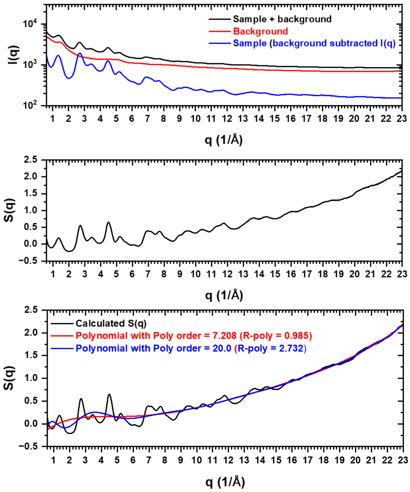

The current Fourier-transform procedure is described in the section “Odd extension and zero filling for the rFFT calculation.” 
It uses low-q zero filling, odd extension and high-q zero padding. The previous one-sided IFFT comparison of zero, 
constant and decay padding has been removed to avoid confusion with the current implementation.
Effect of polynomial correction on G(r)
The upper panel overlays corrections obtained with two polynomial settings on the uncorrected S(q).
The lower panel shows that the higher setting suppresses short-range PDF features. 
This illustrates overcorrection: part of the structural signal is absorbed into the fitted baseline. 
Compare multiple reasonable settings rather than selecting solely for visual smoothness.

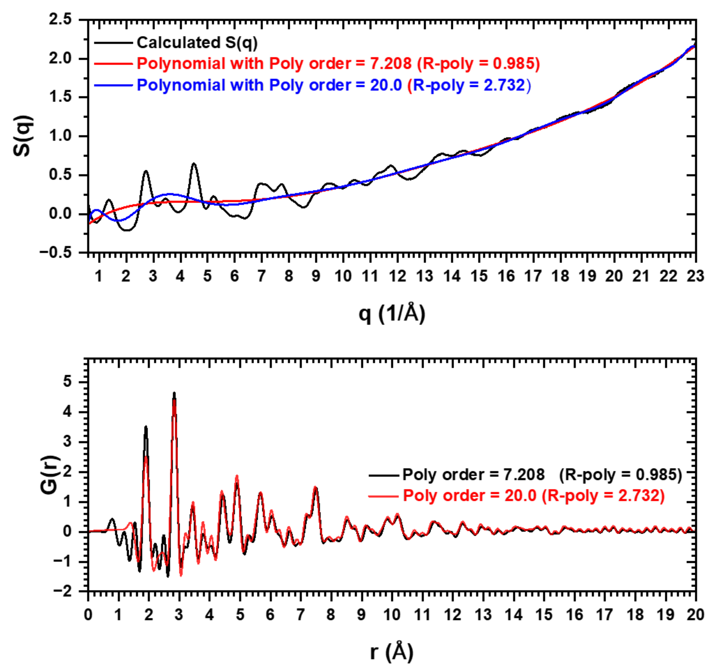

For comparison, S(q) (xPDFsuite_S(q)) obtained from xPDFsuite is also displayed. 
The S(q) profiles are similar overall, with differences in the low-q region.
the middle figure presents the reduced structure function (F(q)) derived from S(q) in Figure d), where F(q) oscillates around 0. 
For comparison, F(q) (xpdfsute_F(q)) from xPDFsuite is also shown. The main F(q) oscillations are similar, although their amplitudes differ.

The lower panel is a legacy comparison of direct-integration and IFFT results. 
The current implementation uses the odd-extension rFFT procedure described earlier; 
this older plot should not be read as a benchmark of the current transform. 
For comparison, G(r) (xpdfsute_G(r)) from xPDFsuite is also shown. 
the principal peak positions and overall PDF profiles are similar; this does not establish identical scaling or absolute normalization accuracy.

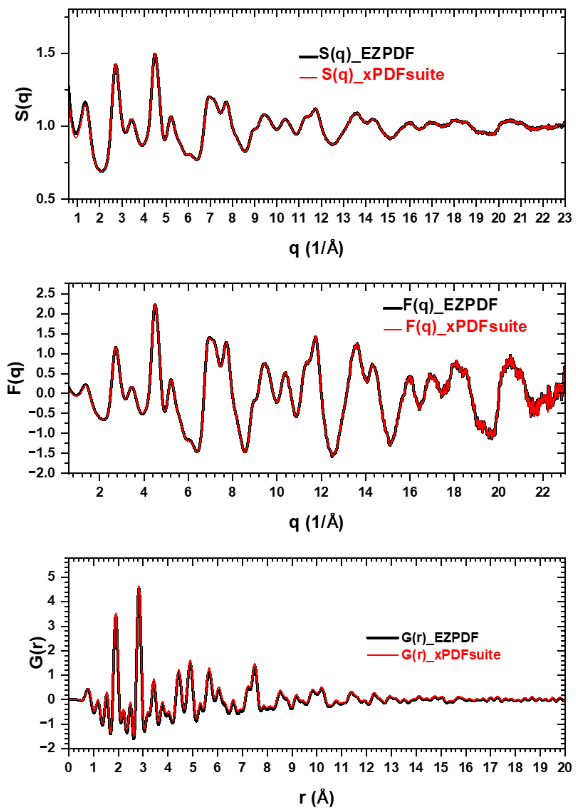

Software comparison
===================
EZPDF is compared with xPDFsuite (the GUI for PDFgetX3) and PDFgetX2 using amorphous cobalt oxide, liquid water and crystalline CeO₂. 
Figures are reproduced from the manuscript; the original numbering is retained.

Amorphous cobalt oxide
====================== 

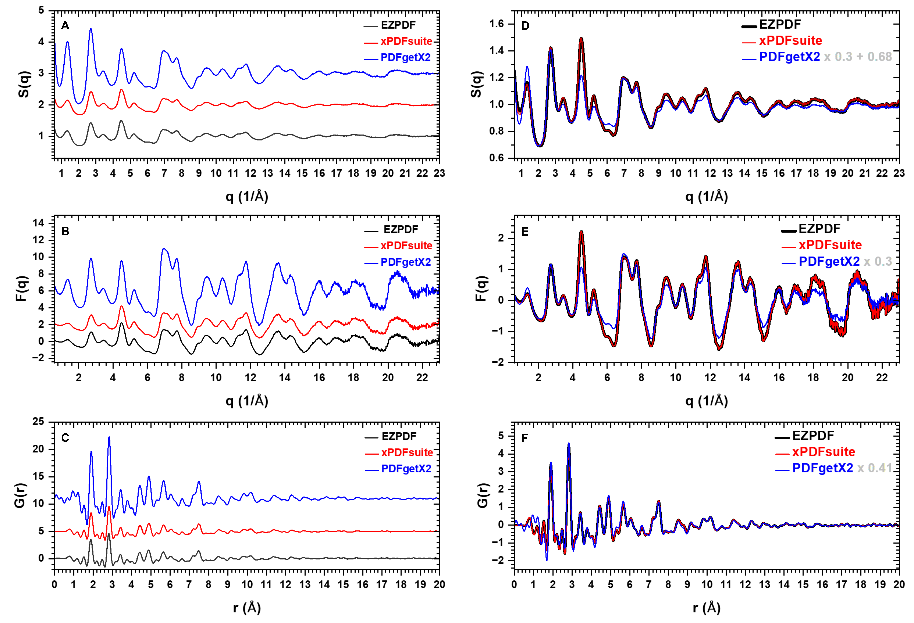

S(q), F(q) and G(r) for amorphous cobalt oxide calculated using EZPDF, xPDFsuite and PDFgetX2. 
(A–C) Profiles offset vertically for clarity. (D–F) Overlaid profiles, with PDFgetX2 rescaled as indicated in the legends. 
Processing limits: qmin = 0.6 Å⁻¹, qmax = 23 Å⁻¹, rmin = 0 Å and rmax = 30 Å. 

The polynomial order in EZPDF was 7.175 (corresponding R-poly ≈ 0.98 Å), and R-poly in xPDFsuite was 0.98 Å. No Lorch modification was applied.
EZPDF and xPDFsuite give closely matching S(q), F(q) and G(r) profiles, including the main PDF peaks near 1.9 and 2.8 Å. 
PDFgetX2 reproduces most feature positions but gives larger unscaled amplitudes. 
In panels D–F, PDFgetX2 is displayed as 0.30 × S(q) + 0.68, 0.30 × F(q) and 0.41 × G(r), respectively. 
After rescaling, the G(r) peaks largely overlap; differences remain near q ≈ 4.5 Å⁻¹ and in some higher-q oscillations.

Liquid water
=============
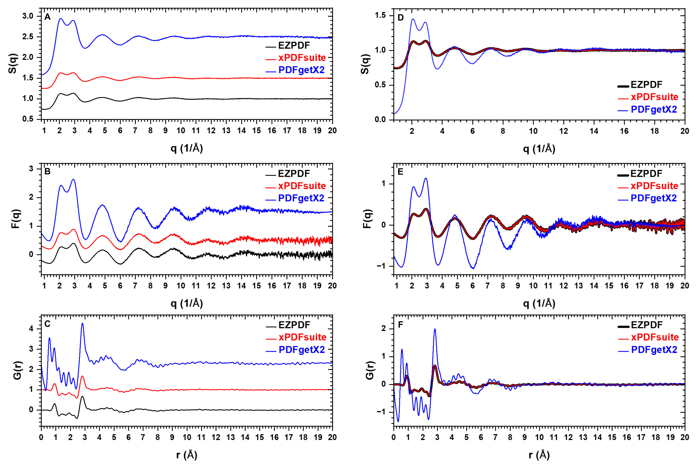

S(q), F(q) and G(r) for water calculated using EZPDF, xPDFsuite and PDFgetX2. 
(A–C) Profiles offset vertically for clarity. (D–F) The same profiles overlaid. 
Processing limits: qmin = 0.8 Å⁻¹, qmax = 20 Å⁻¹, rmin = 0 Å and rmax = 20 Å. The polynomial order in EZPDF was 7.6 (corresponding R-poly ≈ 1.194 Å), 
and R-poly in xPDFsuite was 1.25 Å. PDFgetX2 used Lorch damping and spline extension of F(q) from qmin to q = 0.
PDFgetX2 gives larger S(q) and F(q) oscillations, particularly below q ≈ 10 Å⁻¹, and a lower S(q) baseline below q ≈ 1.5 Å⁻¹. 
The main G(r) peak near 2.8 Å occurs at a similar position in all three results but is substantially higher for PDFgetX2. 
Stronger PDFgetX2 oscillations also occur below 2 Å and over approximately 4–10 Å. 
The PDFgetX2 settings include Lorch damping and low-q spline extension; these processing differences must be considered when comparing the profiles.

Crystalline CeO₂
================
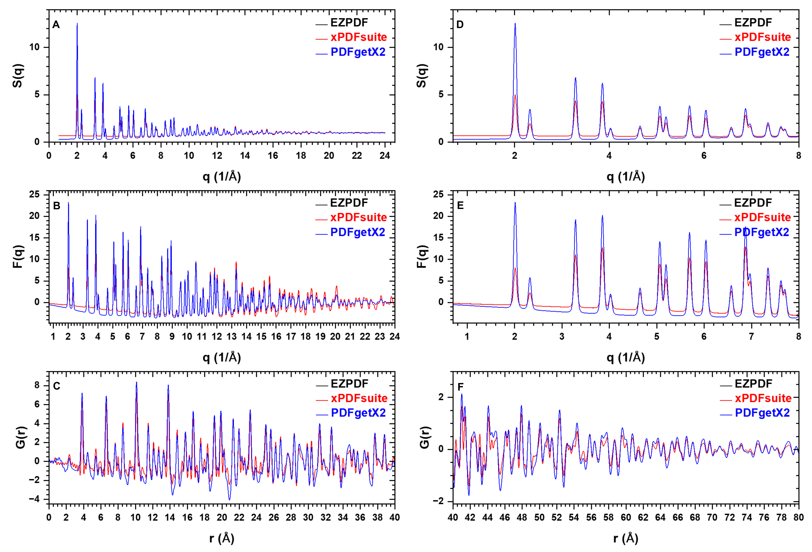
 
Figure 7. S(q), F(q) and G(r) for NIST CeO2 (SRM 674b) calculated using EZPDF, xPDFsuite and PDFgetX2. (A, B) Full reciprocal-space range. 
(D, E) Expanded views below q = 8 Å⁻¹. (C, F) G(r) over r = 0–40 and 40–80 Å, respectively. 
Processing limits: qmin = 0.7 Å⁻¹, qmax = 24 Å⁻¹, rmin = 0 Å and rmax = 100 Å. 
The polynomial order in EZPDF was 7.232 (corresponding R-poly ≈ 0.947 Å), and R-poly in xPDFsuite was 0.97 Å. 
PDFgetX2 used spline extension of F(q) from qmin to q = 0, without Lorch damping.
EZPDF and xPDFsuite closely overlap in S(q), F(q) and G(r). 
PDFgetX2 gives similar peak positions but different amplitudes and baselines, particularly below q = 8 Å⁻¹. 
The G(r) peaks remain closely aligned over r = 0–40 Å, although their amplitudes differ. 
All three results retain long-range oscillations over r = 40–80 Å, consistent with the crystalline character of the sample; 
PDFgetX2 shows generally larger amplitudes in parts of this interval.

Interpretation and limitations
==============================
Agreement in peak positions and profile shape does not establish absolute-intensity accuracy. 
The precise causes of the observed differences have not been determined: direct comparison of the implementations and processing settings is required. 
These examples are not an exhaustive validation, and Gudrun results are not included.

GUI of EZPDF 
=============
The picture shows GUI of EZPDF to process experimental I(q) data to obtain S(q), F(q), G(r). the loaded file, the necessary parameters, 
and the smoothing function are shown. Also, “Open in New Graphs” allows new graph when open each file.
Load file, folder, saved project file which as parameters and file path. View tab show “Dark Mode”.
Select several files and delete all. **File drag-and-drop and deleted file recovery (Undo Delete) functions have been added.** 
EZPDF panel

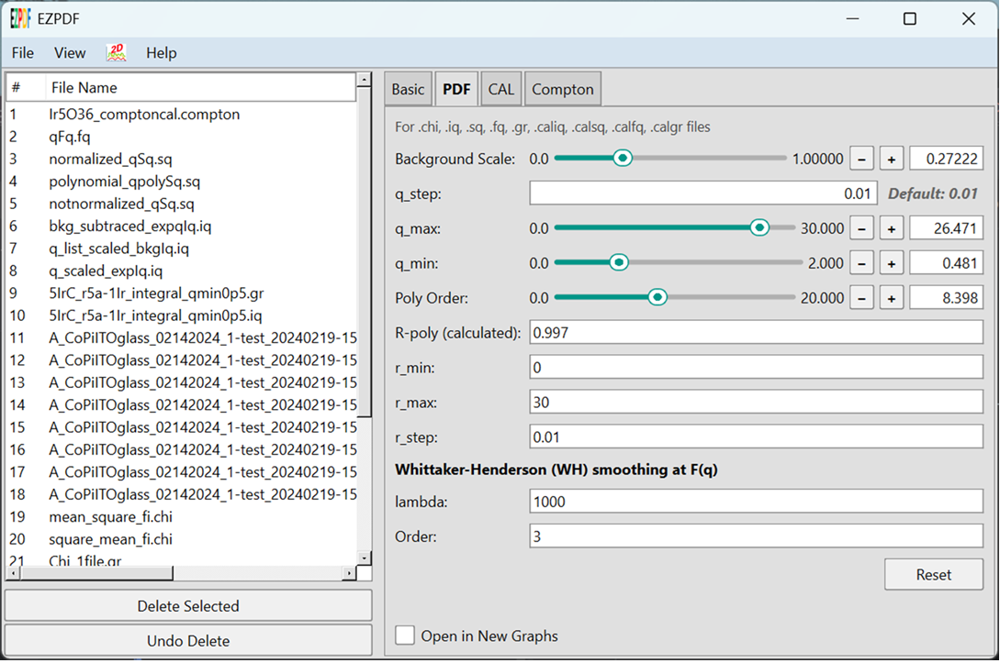

Under “File”, “Open” each file, or selected files or files in folder can be loaded.
“Opne Project” A saved project file” can be loaded.
“Save Project” The parameters of your current working files can be saved as a project file

Under “View”, Changes the GUI theme from Light to Dark Mode.

Clicking the icon launches the EZPDF plot window as a pop-up

The picture shows the EZPDF Plot, displaying I(q) (black) including background data (red), and background subtracted data (blue), 
S(q) with calculated S(q)(black) including polynomial data (red) and polynomial corrected S(q)(blue), F(q) (blue) and smoothed F(q) (black), 
and G(r)(blue) and G(r) (black) from smoothed F(q).
“Lock graph” lock the parameter on the graph. All parameter in “Lock graph” will not be change even though parameters is changed in EZPDF parameter. 
So. You compare data with different data which have different parameters.
Toggles (I(q), S(q), F(q), G(r)) shown in the down right corner) shows specific data only. 

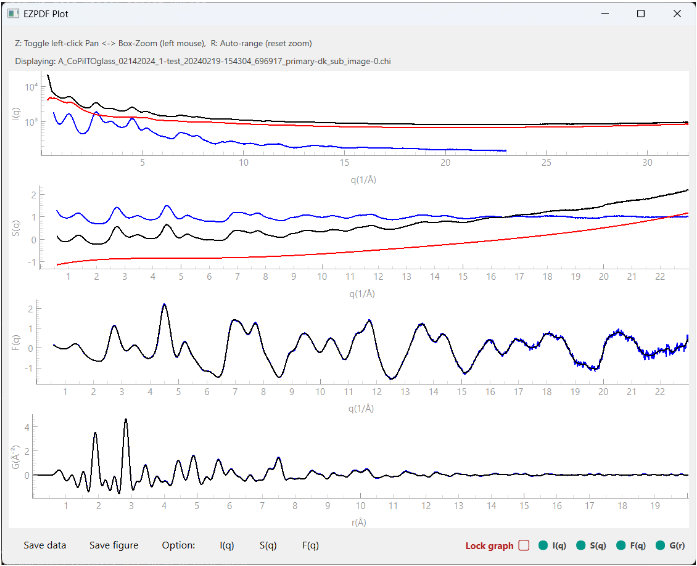

The picture shows “Dark Mode” of EZPDF and EZPDF Plot.

“Save data” saves processed data for experimental data or calculated data from input xyz model data. 
“Save figure” (not shown) saves EZPDDF Plot as PNG, JPEG, SVG, PDF.

EZPDF plot window: multiple plot: 
X Offset and Y Offset are available.
Selective plotting is also available.

Clicking the 'Delete Selected' button will trigger a 'Confirm Deletion' prompt. You can then select either 'Yes' to proceed or 'No' to cancel.

Prerequisites
=============
Environment and installation. The examples in this tutorial were prepared using Python 3.11 on 64-bit Windows. 
Consult the requirements supplied with your downloaded release for dependency versions. 
GUI dependencies include PySide6 and the numerical/plotting packages used by the processing modules. 
Compatibility with other Python versions or operating systems should be checked for the specific release; 
the screenshots below document an example environment, not universal installation requirements.

Dependencies
Core Framework: PySide6 is the primary dependency for the GUI.
Compatibility Check: Before installation, please ensure your Python environment aligns with PySide6 version requirements to prevent library conflicts.

WH smoothing and interpolation with WH_smooth_GUI
=================================================
WH_smooth_GUI is a standalone companion tool for processing selected q intervals after subtraction of a scaled background, 
I_sub(q) = I_sample(q) − αI_background(q). Four modes are available: Whittaker–Henderson (WH) smoothing, 
linear interpolation, automatic cubic-spline interpolation and manual cubic-spline interpolation. 
WH smoothing reduces statistical fluctuations; its strength λ and difference order are set separately for each WH range. 
Larger λ gives stronger smoothing for a fixed order and sampling grid. Manual Spline instead uses editable control points. 
Spline interpolation uses logarithmic intensity when all anchor intensities are positive and linear intensity otherwise. 
The blend width, specified in data points, controls the cosine-taper transition to the unprocessed signal at the range boundaries.
In panel A, the background scale is α = 2.17. The three enabled ranges are: q = 2.00–2.58 / Å, 
Manual Spline with 12 control points and a blend width of 3 points; q = 3.05–4.23 / Å, WH Smooth with λ = 50, 
difference order 1 and a blend width of 15 points; and q = 5.00–20.00 / Å, WH Smooth with λ = 100, 
difference order 2 and a blend width of 20 points. These settings illustrate the displayed dataset and are not recommended defaults.
Panel B shows raw sample intensity (black), the scaled background (blue), 
background-subtracted intensity labelled “Processed I(q)” (red), the final result labelled “Smoothed” (purple), and an optional reference multiplied by 10 (green dashed). 
The final result includes both smoothing and interpolation. Shaded bands identify the processing ranges, and red control points mark the manual spline. 
The lower panel plots ΔI(q) = I_sub(q) − I_final(q); it shows the changes introduced by processing rather than an independent estimate of measurement uncertainty.

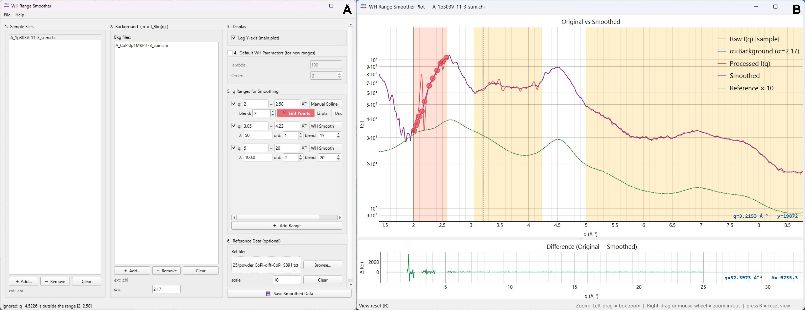

Using the displayed interface
=============================
Add sample and background files to their respective lists, select the sample, and adjust α. 
Use Add Range to define an interval, choose its processing mode and set the relevant parameters. 
For Manual Spline, use Edit Points to adjust the control points while inspecting the plot. 
Compare the input, final result and difference curve before selecting Save Smoothed Data.
Range-selective processing can assist with weak signals from amorphous materials or dilute molecular samples. 
Excessive smoothing can suppress structural oscillations, and interpolation replaces measured values without recovering missing information. 
A scaled reference and a small difference outside the selected ranges do not validate the processed intensity. 
Check the effect on subsequent PDF results and retain the original data.

